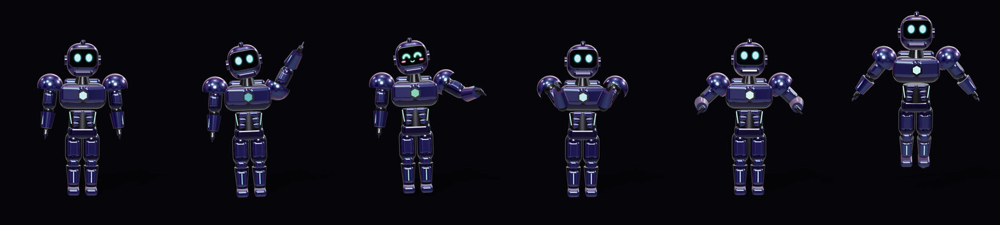
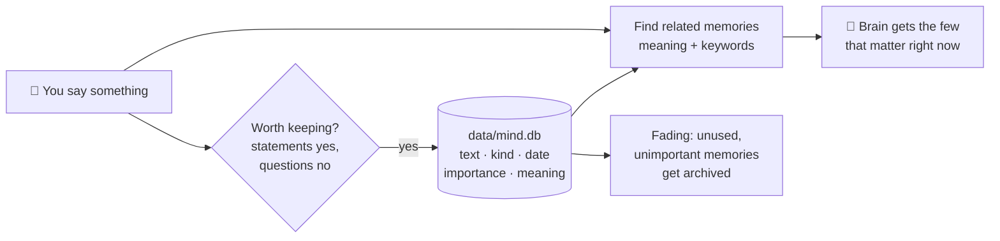

<p align="center">
  
</p>

<p align="center">
  
  <br/><sub>The real 3D Nova: idle · wave · thumbs up · arms crossed · hero pose · flying. Right-click him for 🚀 fly, 👉 point, 👍 thumbs up, 🙅 cross arms and 🦸 hero pose.</sub>
</p>

## Setup (Windows 10/11)

1. **Install Ollama** from https://ollama.com/download, then download Nova's brain:
   ```bash
   ollama pull qwen2.5:7b
   ```
   On a low-end laptop, use `qwen2.5:3b` and change `model` in `settings.toml`.
   For Nova's smart memory search (small, about 270 MB), also run:
   ```bash
   ollama pull nomic-embed-text
   ```
   Without it, Nova still remembers and searches by keywords.
2. **Install Node.js** (LTS) from https://nodejs.org. Nova uses it for his see-through window. The first start sets it up automatically (about a minute).
3. **Install Nova** (Python 3.11 to 3.14. Not 3.15 yet: many packages don't support it):
   ```bash
   git clone https://github.com/HemashreeVI/JarvisAI.git Nova
   cd Nova
   python -m venv venv
   venv\Scripts\activate
   pip install -r requirements.txt
   ```
4. **Edit `settings.toml`**: your name, city, voice, the pet's name, and companion options.
   Nova speaks with a male voice (Andrew) by default. Others: Brian, Guy, Christopher, Prabhat (Indian English) and Ryan (British), or right-click Nova > "Change my voice".
5. **Run**:
   ```bash
   start_nova.bat                 # double-click: picks the right Python for you
   python main.py                 # 3D Nova on your desktop
   python main.py --autostart on  # start Nova every time you log in
   python main.py --shortcut on   # Nova icon on your desktop and Start Menu
   python main.py --no-voice      # typing only
   python main.py --2d            # lightweight 2D body
   python main.py --terminal      # chat in the terminal
   ```
   The first run downloads the speech-recognition model (~150 MB).


## Nova as a desktop app

The first time you run Nova, he puts his purple helmet icon on your **desktop** and in the **Start Menu** (so you can also search for "Nova").

- **Double-click the icon** to start Nova. No black console window pops up.
- **Already running?** Double-clicking brings him back on screen instead of starting a second Nova.
- Deleted the icon and want it back? Right-click the tray icon > **Put Nova on my desktop**, or run:
  ```bash
  python main.py --shortcut on
  ```
  (`--shortcut off` removes it.)

## Move and resize Nova

- **Move him:** drag Nova anywhere on your screen. He remembers the spot next time.
- **Resize him:** scroll the mouse wheel over Nova, use **➖ Smaller / ➕ Bigger** in his click menu, or the tray icon's **Size** menu (with **Reset size**). He remembers his size too.
- **Lost him?** Tray icon > **Bring Nova back to his corner**.

## Nova in your taskbar

While Nova runs, his purple helmet sits in the taskbar's system tray (next to the clock).

- **Left-click** the icon to show or hide Nova.
- **Right-click** it for: bring him back to his corner, put Nova on my desktop, talk, moves (fly, wave, thumbs up, hero pose, dance, cheer me up), mute voice, change voice, quiet time, start Nova when I log in, and **Turn off Nova**.

Windows hides new tray icons behind the **^** arrow at first. To keep Nova always visible, drag his icon from there onto the taskbar, or turn him on in **Settings > Personalization > Taskbar > Other system tray icons**.


## If Nova won't start

- Give him up to a minute: the first start downloads his speech model and sets up his window. Double-clicking again won't start a second Nova, it just waits for the first one.
- Started from the desktop icon, Nova writes what's happening to **`data/nova.log`** (and the 3D window to `data/window.log`). Open it to see what went wrong.
- Still stuck? Double-click `start_nova.bat` instead: it shows everything in a console window.

## Optional: WhatsApp and Gmail

- **WhatsApp:** run `pip install pywhatkit`, copy `data/contacts.example.json` to `data/contacts.json`, and fill in the numbers. You need to be logged in to WhatsApp Web.
- **Gmail:** run `pip install google-api-python-client google-auth-oauthlib`. Create an OAuth client (Desktop app) in Google Cloud Console with the Gmail API enabled, and save it as `data/credentials.json`.

Everything in `data/` (memory, mood diary, activity log, contacts, tokens) stays private and is git-ignored.


## Teach Nova a new skill

Drop a file into `nova/skills/`. It's picked up automatically:

```python
from nova.tools import tool

@tool("Flip a coin.")
def flip_coin() -> str:
    import random
    return random.choice(["Heads!", "Tails!"])
```

Use `@tool(..., dangerous=True)` for anything risky. Nova will then ask before running it.


## How Nova's memory works



- **What's saved:** facts (*"I study CSE at VIT"*), likes (*"I love dosa"*), goals (*"I want to learn ML"*), and deadlines with real dates (*"CSE2004 assignment due tomorrow"* is saved with the actual date, so "tomorrow" never goes stale). Course codes become tags.
- **What's skipped:** questions, commands and small talk.
- **Repeats** strengthen a memory instead of creating a copy.
- **Fading:** each memory has a strength from its importance, how often it comes up, and how long since it was last used. Pinned memories and upcoming dates stay strong; passed dates fade within about a week. Faded memories are archived, never silently deleted.
- **Settings:** the `[memory]` section in `settings.toml`.


## Running the tests

```bash
pip install pytest
python -m pytest tests
```


## Project structure

```
main.py              start here
settings.toml        your settings
nova/
  app.py             wires everything together
  brain.py           local LLM + personality + tool use
  emotion.py         reads your mood, decides how Nova reacts
  voice_tone.py      mood from how you sound (learns your normal voice)
  listener.py        mic, "Hey Nova", speech-to-text
  speaker.py         male neural voice styled by mood (+ offline backup)
  companion.py       welcome/goodbye, check-ins, breaks, activity log
  presence.py        lid open/close, lock/unlock, sleep/wake, active app (Windows)
  body_electron.py   the see-through always-on-top 3D window (Electron, in shell/)
  body3d.py          fallback 3D window (pywebview)
  body/              three.js: Nova's armored 3D body, visor eyes (eyes.js) and Pip
  buddy.py           lightweight 2D body (fallback)
  memory.py          chat history, simple facts and mood diary
  mind/              long-term memory engine: search by meaning, fading, deadlines (data/mind.db)
  tray.py            tray icon (show / hide, moves, quiet, turn off)
  launcher.py        desktop + Start Menu icon, one Nova at a time
  skills/            everything Nova can do
tests/               automated tests (python -m pytest tests)
data/                private stuff (git-ignored)
```

<div align="center">

<sub>Thinking happens on your PC. Nothing leaves it ✨</sub><br/>
💜 Built by <a href="https://github.com/HemashreeVI">Hemashree VI</a>

</div>
